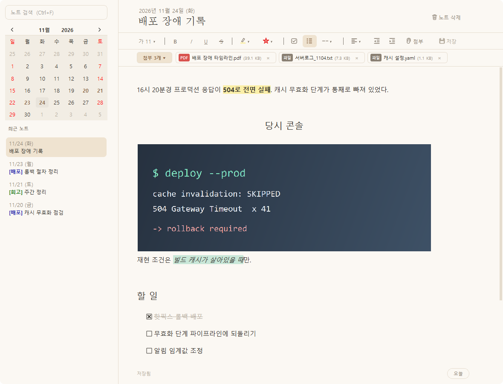
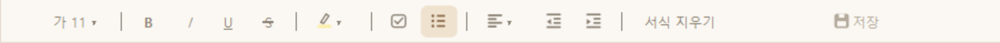
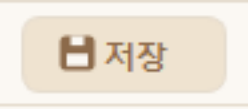

# 노트 메모 (note_memo)

날짜별로 노트가 한 장씩 생기는 윈도우용 다이어리 앱.
**`Win`+`Shift`+`S` 로 캡쳐 → `Ctrl`+`V`** 두 단계로, 필기 중인 자리에 스크린샷이 바로 들어갑니다.



종이 다이어리 느낌의 화면에 텍스트·서식·스크린샷을 한곳에 모읍니다.
외부 의존성은 **PySide6 하나뿐**입니다 — 클립보드 이미지를 Qt가 직접 처리하므로
이미지 라이브러리도 필요 없습니다.

## 실행

```bash
git clone https://github.com/JeA-dev/note_memo.git
```

받은 폴더의 **`run.bat`** 을 더블클릭하세요.
처음 한 번만 가상환경을 만들고 PySide6를 설치하며, 그 뒤로는 콘솔 창 없이 바로 뜹니다.
(윈도우 10/11 + 파이썬 3.10 이상)

명령으로 실행하려면:

```bash
.venv\Scripts\python.exe main.py
```

파이썬이 없는 컴퓨터에 넘길 단일 실행 파일은 아래 **배포용 실행 파일 만들기** 를 보세요.

<details>
<summary>바탕화면 바로가기 만들기</summary>

```bash
powershell -ExecutionPolicy Bypass -File tools\create_shortcut.ps1
```

`pythonw.exe` 를 직접 가리켜 콘솔 창 없이 뜨고 아이콘도 붙습니다.

> `run.bat` 은 **반드시 CRLF 줄바꿈**이어야 합니다. LF로 저장하면 cmd.exe가 여러 줄을
> 한 줄로 붙여 읽어서 아무 일도 일어나지 않습니다. `.gitattributes` 로 못박아 뒀습니다.

</details>

앱이 조용히 죽으면 `문서\NoteMemo\error.log` 에 원인이 남습니다
(`pythonw.exe` 로 띄우면 콘솔이 없어 오류가 화면에 나오지 않기 때문입니다).

## 스크린샷 붙여넣기

1. `Win+Shift+S` 로 화면을 캡쳐한다 (윈도우 캡쳐도구가 클립보드에 이미지를 올린다)
2. 앱으로 돌아와 `Ctrl+V`

커서 위치에 인라인으로 들어가고, 본문 폭에 맞게 자동으로 축소됩니다.
붙여넣으면 각자 다른 줄에 놓이는데, 사이의 줄바꿈을 `Backspace` 로 지우면
**두 장을 같은 줄에 나란히** 둘 수 있습니다.
**원본 해상도 PNG는 따로 보관**되므로 이미지를 더블클릭하면 기본 뷰어에서 원본 크기로 열립니다.
이미지 파일을 복사하거나 창으로 끌어다 놓아도 똑같이 들어갑니다.

## 파일 첨부

스샷이 아닌 파일(PDF·동영상·문서 등)은 본문에 넣지 않고 노트에 **붙여** 둡니다.

- 툴바의 **첨부** 버튼을 누르거나, 파일을 본문에 **끌어다 놓으면** 됩니다
- 그날의 `attachments\` 폴더로 복사되므로 원본을 지워도 노트에 남습니다
- 본문 위 칩 목록에서 **열기 · 폴더에서 보기 · 본문에 삽입 · 삭제** 를 할 수 있습니다
- 칩이 한 줄을 넘치면 접히고, `첨부 N개` 에 마우스를 올리면 전체 목록이 펼쳐집니다
- 검색은 첨부파일 **이름도 함께** 훑습니다

## 서식



왼쪽부터 글자 크기 · 굵게 · 기울임 · 밑줄 · 취소선 · 형광펜(3색) · **빨간 별표** ·
체크박스 · 목록 · **구분선** · 정렬 · 내어쓰기 · 들여쓰기 · 첨부, 오른쪽 끝이 저장 버튼입니다.
`▾` 가 붙은 것은 눌러서 고르는 드롭다운이고, 나머지는 켜고 끄는 토글입니다.
버튼에 마우스를 올리면 이름과 단축키가 나옵니다.

**빨간 별표**는 손글씨 느낌의 인라인 이미지라 글자 크기를 따라갑니다. 빈 별과 찬 별 두 가지입니다.
**구분선**은 점선 · 실선 · 굵은선 · 이중선 네 가지이고, 줄 전체에 `---` `***` `___` 를 치고
`Enter` 를 눌러도 만들어집니다.

## 단축키

| 키 | 동작 |
|---|---|
| `Ctrl+V` | 클립보드 스샷 / 텍스트 삽입 |
| `Ctrl+Shift+V` | 서식 없이 붙여넣기 |
| `Ctrl+B` `Ctrl+I` `Ctrl+U` | 굵게 / 기울임 / 밑줄 |
| `Ctrl+Shift+X` | 취소선 |
| `Ctrl+H` | 형광펜 (툴바에서 고른 마지막 색) |
| `Ctrl+=` `Ctrl+-` | 글자 크기 키우기 / 줄이기 |
| `Ctrl+0` | 글자 크기를 기본(11)으로 |
| `Ctrl+Shift+C` | 체크박스 |
| `Ctrl+Shift+8` | 목록 |
| `Ctrl+Shift+L` `E` `R` `J` | 정렬 — 왼쪽 / 가운데 / 오른쪽 / 양쪽 |
| `Tab` `Shift+Tab` | 들여쓰기 / 내어쓰기 (문단 단위, 최대 12단계) |
| `Ctrl+S` | 즉시 저장 |
| `Ctrl+T` | 오늘로 이동 |
| `Ctrl+F` | 검색창으로 |
| `Alt+←` `Alt+→` | 이전 / 다음 날짜 |
| `Ctrl+Shift+Delete` | 지금 노트 삭제 (확인 후) |

타이핑 중 자동 서식 — 줄 맨 앞에서 아래를 치고 스페이스:

| 입력 | 결과 |
|---|---|
| `- ` | 목록 |
| `[] ` | 체크박스 |

줄 전체를 `---` `***` `___` 로 채우고 `Enter` 를 누르면 구분선이 됩니다.

`Ctrl+Z` 한 번이면 되돌아갑니다. 체크박스는 마우스로 네모를 눌러 켜고 끕니다.

서식 관련 단축키(굵게·크기·정렬·체크박스·목록·형광펜)는 **본문에 커서가 있을 때만** 동작합니다.
제목 칸이나 검색창에서 눌러도 포커스를 빼앗지 않습니다.
`Ctrl+S` `Ctrl+T` `Ctrl+F` `Alt+←/→` 는 어디서든 동작합니다.

## 노트 구성

노트 한 장은 세 칸으로 나뉩니다.

| 칸 | 내용 |
|---|---|
| 날짜 | 그날의 날짜. 캘린더에서 고릅니다 |
| 제목 | 그날 노트의 제목. 서식 없는 한 줄이고, `Enter` 를 누르면 본문으로 넘어갑니다 |
| 내용 | 서식·스샷이 들어가는 본문 |

**최근 노트 목록에는 제목만 보입니다.** 제목을 비워두면 `제목 없음` 으로 표시됩니다.
검색은 제목과 본문을 함께 훑습니다.

제목 칸이 따로 있으므로 본문에는 제목 서식을 두지 않습니다. 소제목이 필요하면
**글자 크기**를 키우세요 (툴바 왼쪽 `가 11` 드롭다운, 또는 `Ctrl+=` / `Ctrl+-`).
고를 수 있는 크기는 8·9·10·11·12·14·16·18·22·28 이고 기본은 11 입니다.

정렬과 들여쓰기는 문단 단위입니다. **이미지 문단도 정렬·들여쓰기되므로 스샷을 가운데 놓을 수 있습니다.**

들여쓰기는 `Tab` / `Shift+Tab` 또는 툴바의 들여쓰기·내어쓰기 버튼으로 합니다.
**공백을 여러 번 치지 않아도 됩니다** — 공백으로 맞추면 글자 크기를 바꿀 때 어긋납니다.

## 화면 구성

본문은 읽기 편한 폭(780px)을 유지하고, 창을 넓히면 남는 공간은 **오른쪽으로만** 늘어납니다.
전체 화면에서도 날짜·제목·툴바·본문·상태줄의 왼쪽 끝이 한 선에 맞고, 오른쪽 끝(저장 버튼, 오늘 버튼)도
본문 단 폭에서 끝나 한 덩어리로 보입니다.

서식 툴바는 크기가 통일된 아이콘 한 줄입니다. 각 버튼에 마우스를 올리면 이름과 단축키가 나옵니다.
`▾` 가 붙은 것(크기·형광펜·정렬)은 눌러서 고르는 드롭다운이고, 나머지는 켜고 끄는 토글입니다.
켜져 있으면 배경과 아이콘 색이 함께 바뀝니다.

## 저장 방식

편집을 멈추면 1.5초 뒤 자동 저장되고, 날짜를 옮기거나 창을 닫을 때도 저장됩니다.



툴바 오른쪽의 **저장 버튼**은 저장할 게 있으면 진해지고 저장을 마치면 흐려져서,
버튼만 봐도 지금 저장된 상태인지 알 수 있습니다.
저장 위치는 `문서\NoteMemo\` 입니다.

```
문서\NoteMemo\
  notes\2026-08-28.json                            하루치 노트
  images\2026-08-28\img_20260828-143022-a1b2.png   그날 붙인 스샷 원본
  attachments\2026-08-28\att_...-7b2c_타임라인.pdf  그날 첨부한 파일
```

노트는 사람이 읽을 수 있는 JSON입니다. 문단이 블록, 같은 서식이 이어지는 구간이 run 입니다.

```json
{
  "version": 1,
  "date": "2026-08-28",
  "title": "배포 장애 기록",
  "blocks": [
    { "type": "text", "runs": [
        { "text": "원인은 " },
        { "text": "캐시 무효화 누락", "b": true, "hl": "#FBEFA8" }
    ]},
    { "type": "todo", "checked": false, "runs": [{ "text": "롤백 스크립트 점검" }] },
    { "type": "divider", "style": "dashed", "runs": [] },
    { "type": "text", "align": "center", "runs": [
        { "image": "img_20260828-143022-a1b2.png" },
        { "image": "img_20260828-143512-9f3c.png" }
    ]}
  ],
  "attachments": [
    { "name": "att_20260828-143900-7b2c_타임라인.pdf",
      "original_name": "타임라인.pdf", "size": 39104, "type": "pdf" }
  ]
}
```

블록 타입은 `text` `bullet` `todo` `divider`,
run 플래그는 `b`(굵게) `i`(기울임) `u`(밑줄) `s`(취소선) `hl`(형광펜 색) `sz`(글자 크기) 입니다.
블록에는 `align`(정렬)과 `indent`(들여쓰기 단계)가 붙고, 둘 다 기본값이 아닐 때만 저장됩니다.
구분선 블록은 `style` 로 모양을 적습니다.

**빨간 별표도 run 입니다** (`{"star": "sketch"}` 또는 `"filled"`). 이미지와 마찬가지로
문단 안에 글자와 섞여 들어가고, `sz` 로 글자 크기를 따라갑니다.

**첨부파일은 블록이 아니라 노트 단위 목록**(`attachments`)입니다. 본문 어디에도 끼어들지 않고
노트 한 장에 딸린 파일이라서입니다. `name` 은 저장된 파일명, `original_name` 은 붙일 때의 원래 이름입니다.

**이미지는 블록이 아니라 run 입니다** (`{"image": "파일명"}`). 한 문단에 스샷을 둘 나란히
놓을 수 있어야 하기 때문입니다. 이미지를 독립 블록으로 두면 저장할 때마다 줄이 나뉩니다.
옛 형식의 `{"type": "image", "file": ...}` 블록은 읽는 시점에 이미지 run 하나를 가진 문단으로
자동 변환됩니다 (정렬·들여쓰기도 함께 옮겨집니다).

> `indent` 는 **꼭 저장해야 하는 값**입니다. Qt 는 목록 항목에서 `Backspace` 로 빠져나갈 때
> 글자가 제자리에 남도록 들여쓰기를 올려 두는데, 이 값을 빼먹으면 다시 열었을 때
> 그 줄만 왼쪽으로 튀어 버립니다.

### 옛 노트 자동 변환

예전에는 본문에 제목1/제목2 서식이 있었고, 제목 칸이 없어서 본문 첫 줄의 제목1을 노트 제목으로 썼습니다.
옛 노트를 열면 읽는 시점에 자동으로 정리됩니다.

1. `title` 키가 **없는** 파일이면 → 본문 맨 앞의 제목1을 제목 칸으로 올리고 본문에서 뺍니다.
   `title` 키가 있으면 빈 문자열이어도 이미 새 형식이라 본문을 건드리지 않습니다.
2. 남아 있는 제목1/제목2 블록은 → 일반 문단 + 글자 크기 `sz` 17 / 14 로 바뀝니다. 강조가 사라지지 않습니다.

변환은 디스크를 바로 고치지 않고, 그 노트를 저장할 때 확정됩니다.
지원하는 서식이 이 목록으로 닫혀 있어서, 외부에서 복사해 온 서식은 들어오지 않습니다
(브라우저에서 복사하면 평문으로만 붙습니다. 앱 안에서 복사할 때만 서식이 유지됩니다).

**제목과 본문이 모두 빈** 날은 파일을 만들지 않습니다. 제목만 적어둔 날은 파일이 남습니다.
노트를 통째로 지우면 파일도 지워집니다.

**지운 스샷 파일은 자동으로 삭제하지 않습니다.** 실수로 지웠을 때 되살릴 수 있게 하기 위해서입니다.
쌓인 파일을 정리하려면:

```bash
.venv\Scripts\python.exe -m tools.clean_orphans
```

어느 노트에서도 참조하지 않는 이미지·첨부파일을 찾아 보여줍니다. 기본은 미리보기라
파일을 건드리지 않고, `--apply` 를 붙이면 `_orphans_<시각>\` 폴더로 **옮깁니다**(지우지 않습니다).
확인한 뒤 그 폴더를 직접 지우면 공간이 확보됩니다.

- 노트 하나라도 읽지 못하면 **아무것도 건드리지 않고 멈춥니다** — 그 노트가 쓰는 파일을
  고아로 잘못 치울 수 있기 때문입니다.
- 최근 10분 안에 만들어진 파일은 건드리지 않습니다. 방금 붙여 아직 저장되지 않은
  스샷이 휩쓸리지 않게 하기 위해서입니다.

## 테스트

```bash
.venv\Scripts\python.exe -m tests.test_serializer
```

```bash
.venv\Scripts\python.exe -m tests.test_app
```

```bash
.venv\Scripts\python.exe -m tests.test_attachment
```

```bash
.venv\Scripts\python.exe -m tests.test_clean_orphans
```

`test_serializer` 는 블록 JSON ↔ 문서 왕복이 정확한지(데이터 유실이 없는지),
`test_app` 은 창을 오프스크린으로 띄워 붙여넣기·서식·저장·복원 배선을,
`test_attachment` 는 첨부파일 복사·메타데이터·삭제를,
`test_clean_orphans` 는 고아 파일 정리가 참조된 파일을 건드리지 않는지 검증합니다.
모두 임시 폴더를 쓰므로 실제 노트를 건드리지 않습니다.

디자인을 눈으로 확인하려면 (오프스크린에는 폰트가 없으므로 실제 플랫폼으로 실행):

```bash
QT_QPA_PLATFORM=windows .venv/Scripts/python.exe -m tests.preview_shot preview.png
```

## 배포용 실행 파일 만들기

파이썬이 없는 컴퓨터에 넘길 때는 단일 exe 로 뽑는다.

```bash
.venv\Scripts\python.exe -m pip install pyinstaller
```

```bash
.venv\Scripts\python.exe -m tools.build_exe
```

`dist\노트메모.exe` (약 45MB) 가 나온다. 첫 실행 5~6초, 이후 3초.

> `.venv` 폴더는 **다른 컴퓨터로 복사해도 동작하지 않는다** (이 컴퓨터의 파이썬 경로가
> 절대경로로 박혀 있다). 소스를 넘길 때는 `.venv` 를 빼고 `run.bat` 이 새로 만들게 한다.

실행 파일은 뜨는 데 몇 초 걸려서 조급하게 두 번 누르기 쉽다. 두 인스턴스가 같은 노트를
자동저장하면 서로를 덮어쓰므로 `QSharedMemory` 로 중복 실행을 막아 뒀다 (`main.py`).

## 구조

| 파일 | 역할 |
|---|---|
| `notememo/config.py` | 저장 경로, 날짜 포맷 |
| `notememo/theme.py` | 팔레트, 폰트 스택, QSS |
| `notememo/storage.py` | 노트 JSON·이미지 입출력, 검색 (mtime 캐시) |
| `notememo/formatting.py` | 서식의 단일 진실 공급원 — Qt 매핑, 토글, 자동 서식 |
| `notememo/serializer.py` | 문서 ↔ 블록 JSON 변환, 이미지 크기 계산 |
| `notememo/editor.py` | 필기 영역 — 붙여넣기, 폭 맞춤, 체크박스 클릭 |
| `notememo/toolbar.py` | 서식 툴바 |
| `notememo/sidebar.py` | 검색·캘린더·노트 목록 |
| `notememo/header.py` | 날짜 섹션 + 제목 섹션 |
| `notememo/layout.py` | 본문 단 폭에 맞춰 끝나는 가로줄 (헤더·툴바·상태줄 공용) |
| `notememo/attachment.py` | 첨부파일 칩 목록 — 자동 줄바꿈 FlowLayout, 전체 목록 팝업 |
| `notememo/main_window.py` | 조립, 자동저장, 단축키 |
| `tools/build_exe.py` | 배포용 단일 실행 파일 빌드 |
| `tools/make_screenshots.py` | README 용 화면 이미지(`docs/`) 생성 |
| `tools/clean_orphans.py` | 참조가 끊긴 이미지·첨부파일 정리 (기본은 미리보기) |
| `tools/convert_space_indent.py` | 공백으로 맞춘 들여쓰기를 `indent` 로 변환 (기본은 미리보기) |
| `tools/make_icon.py` | 바로가기 아이콘(`assets/note_memo.ico`) 생성 |
| `tools/create_shortcut.ps1` | 바탕화면 바로가기 생성 |
